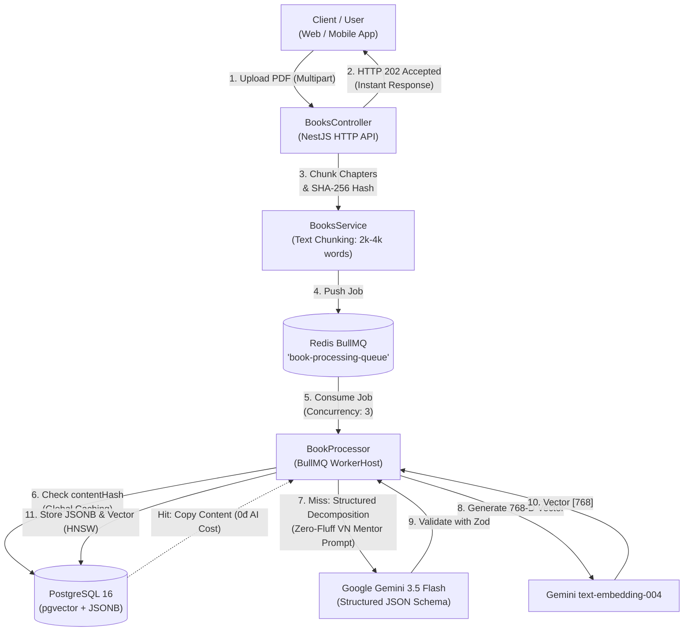

# AuraMind Core Backend & AI Processing Pipeline

> **AuraMind** — Hệ thống bóc tách tri thức sách chuyên sâu, trực quan hóa kiến thức và tìm kiếm ngữ nghĩa thông minh (Semantic RAG) chạy trên nền tảng **NestJS, PostgreSQL 16 (pgvector), Redis (BullMQ), và Google Gemini 3.5 API**.

---

## 🏛️ Kiến Trúc Tổng Thể



---

## 🚀 Khởi Chạy Nhanh Bằng Docker Compose

### 1. Chuẩn bị biến môi trường
File `.env` đã được cấu hình sẵn với Gemini API Key của bạn:
```bash
cp .env.example .env
```

### 2. Khởi chạy toàn bộ hạ tầng
```bash
docker-compose up -d --build
```
Dịch vụ bao gồm:
- **PostgreSQL 16 (`auramind_postgres`)**: Cổng `5432` với `pgvector` và extension `uuid-ossp` được kích hoạt tự động qua `docker/init.sql`.
- **Redis 7 (`auramind_redis`)**: Cổng `6379` phục vụ hàng đợi BullMQ và cache.
- **NestJS App (`auramind_api`)**: Cổng `4000`, chạy Multi-Stage build trên Node.js Alpine non-root (`node`).

### 3. Khởi tạo Index Tối ưu
Sau khi Prisma migrate bảng, chạy script index tối ưu hóa:
```bash
docker exec -i auramind_postgres psql -U auramind -d auramind < prisma/indexes.sql
```

---

## 🔌 API Endpoints Chính

| Method | Endpoint | Mô tả |
|---|---|---|
| `POST` | `/books/upload` | Tải lên sách PDF/EPUB. Trả về ngay **HTTP 202 Accepted** với ID sách và số lượng job hàng đợi. |
| `GET` | `/books/:id` | Xem tiến độ bóc tách của toàn bộ các chương trong sách. |
| `GET` | `/books/chapters/:id` | Lấy chi tiết tri thức bóc tách JSONB (Summary, Mindmap, Flashcards, Steps...). |
| `GET` | `/books/search/semantic?q=...` | Tìm kiếm ngữ nghĩa chéo sách qua pgvector với Cosine Similarity. |

---

## 💎 Cấu Trúc Dữ Liệu JSONB Bóc Tách (Schema Chuẩn)

```json
{
  "chapterNumber": 1,
  "title": "Bản chất của độ tin cậy trong hệ thống phân tán",
  "coreSummary": "Tóm tắt 300-500 từ theo phong cách Zero-Fluff, trực diện...",
  "simplifiedExplanation": {
    "analogy": "Giống như việc tổ chức một quán cafe đông khách vào giờ cao điểm...",
    "realWorldExample": "Cách Shopee xử lý hàng triệu đơn hàng trong ngày Siêu Sale 11.11...",
    "keyTakeaway": "Hệ thống tốt không phải là hệ thống không bao giờ lỗi, mà là hệ thống biết cô lập vùng ảnh hưởng khi có sự cố."
  },
  "mindmap": [
    { "id": "node-1", "label": "Độ tin cậy (Reliability)", "parentId": null, "description": "Khả năng tiếp tục hoạt động đúng ngay cả khi có lỗi phần cứng hoặc phần mềm" }
  ],
  "actionableSteps": [
    { "stepNumber": 1, "action": "Thiết lập Circuit Breaker cho mọi lời gọi mạng ra ngoài", "practicalTips": "Sử dụng ngưỡng timeout tối đa 2.5s và kích hoạt fallback sau 5 lần lỗi liên tiếp" }
  ],
  "flashcards": [
    { "question": "Fault khác Failure ở điểm cốt lõi nào?", "answer": "Fault là sự cố ở một thành phần; Failure là khi toàn bộ hệ thống ngừng phục vụ người dùng.", "tip": "Fault là mầm mống, Failure là hậu quả." }
  ]
}
```
