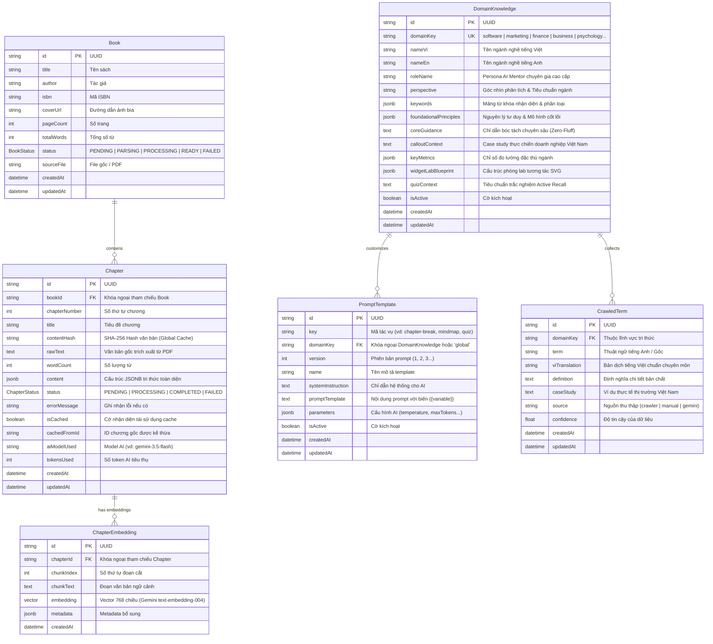

# 📚 Breaking Books — Kiến Trúc Cơ Sở Dữ Liệu & Hệ Tri Thức Đa Ngành

Tài liệu thiết kế chi tiết kiến trúc Cơ sở dữ liệu (PostgreSQL 16 + pgvector + JSONB) và Hệ thống Tri thức Đa ngành (Multi-Domain Knowledge Base) của **Breaking Books v2.0**.

---

## 1. Sơ Đồ Thực Thể - Mối Quan Hệ (Entity-Relationship Diagram)



---

## 2. Chi Tiết Các Bảng Trong Hệ Thống

### 2.1 Bảng `books` (Quản lý Sách)
Lưu trữ thông tin metadata của cuốn sách được tải lên hoặc có sẵn trong thư viện.
* **id** (`TEXT PRIMARY KEY`): Mã định danh duy nhất (UUID).
* **title** (`TEXT NOT NULL`): Tựa đề sách.
* **author** (`TEXT`): Tác giả cuốn sách.
* **status** (`ENUM BookStatus`): Trạng thái xử lý (`PENDING`, `PARSING`, `PROCESSING`, `READY`, `FAILED`).
* **sourceFile** (`TEXT`): Đường dẫn lưu trữ file PDF gốc hoặc thư mục sách.
* **Indexes**: `status`, `createdAt`.

---

### 2.2 Bảng `chapters` (Chương Sách & Tri Thức Bóc Tách)
Lưu trữ nội dung tri thức đã được Gemini AI chuyển đổi thành cấu trúc JSONB.
* **id** (`TEXT PRIMARY KEY`): UUID chương.
* **bookId** (`TEXT NOT NULL`): Khóa ngoại tham chiếu `books.id` (Xóa cascade).
* **chapterNumber** (`INTEGER NOT NULL`): Số thứ tự chương (1, 2, 3...).
* **contentHash** (`VARCHAR(64) NOT NULL`): **SHA-256 Hash** của nội dung văn bản gốc. Dùng cho lớp **Global Caching Layer**: Nếu cùng một chương hoặc nội dung tương tự được tải lên, chi phí gọi AI là **$0** và độ trễ là **0ms**.
* **rawText** (`TEXT`): Toàn văn gốc chương sách (đã loại bỏ null bytes).
* **content** (`JSONB`): Cấu trúc tri thức toàn diện:
  - `viTitle`, `enTitle`, `chapterLead`, `coreSummary`.
  - `simplifiedExplanation`: Ẩn dụ gần gũi, ví dụ thực chiến Việt Nam, câu chốt giá trị.
  - `mindmap`: Cây tư duy phân nhánh.
  - `actionableSteps`: Các bước hành động áp dụng ngay.
  - `flashcards`: Thẻ ghi nhớ Active Recall.
  - `topics`: Mảng bài học kèm thẻ lý thuyết (`prose`, `callout`) và phòng thí nghiệm tương tác (`widget`).
  - `quizzes`: Trắc nghiệm 4 phương án kèm giải thích chi tiết.
  - `glossary`: Thuật ngữ chuyên môn chuẩn hóa.
* **status** (`ENUM ChapterStatus`): `PENDING`, `PROCESSING`, `COMPLETED`, `FAILED`.
* **Indexes**: `UNIQUE(bookId, chapterNumber)`, `idx_chapters_content_hash`, `GIN(content jsonb_path_ops)`.

---

### 2.3 Bảng `domain_knowledge` (Kho Tri Thức Đa Ngành)
Lưu trữ kiến thức nền tảng, chuyên gia đại diện, từ khóa nhận diện, và cấu trúc phòng thí nghiệm trực quan cho **12 ngành nghề chuyên sâu**:
1. `software`: Công nghệ Thông tin, Kỹ thuật Phần mềm & Hệ thống Phân tán.
2. `marketing`: Tiếp thị, Thương hiệu, Phễu chuyển đổi & Tăng trưởng.
3. `finance`: Tài chính Doanh nghiệp, Đầu tư Giá trị & Quản trị Dòng tiền.
4. `business`: Quản trị Kinh doanh, Mô hình Doanh nghiệp & Vận hành Chuỗi giá trị.
5. `psychology`: Tâm lý học Ứng dụng, Khoa học Hành vi & Não bộ.
6. `product_design`: Quản trị Sản phẩm, UI/UX & Design Thinking.
7. `sales`: Nghệ thuật Bán hàng Tư vấn, Đàm phán Đỉnh cao & Dealmaking.
8. `leadership`: Lãnh đạo, Văn hóa Doanh nghiệp & Xây dựng Đội ngũ.
9. `economics`: Kinh tế học Vĩ mô, Lý thuyết Trò chơi & Mô hình Tư duy Đa ngành.
10. `health`: Y học Chức năng, Dinh dưỡng, Nhịp sinh học & Thể chất.
11. `science`: Khoa học Tự nhiên, Vật lý, Toán học & Tư duy Nguyên lý Thứ nhất.
12. `general`: Kỹ năng Đời sống, Năng suất & Tri thức Phổ quát.

* **domainKey** (`TEXT UNIQUE NOT NULL`): Khóa định danh ngành.
* **keywords** (`JSONB`): Danh sách hàng chục/hàng trăm từ khóa và biến thể tiếng Anh/tiếng Việt.
* **foundationalPrinciples** (`JSONB`): Các mô hình tư duy, định luật nền tảng của ngành (ví dụ: CAP Theorem, 4P/7P, Margin of Safety, Double Diamond...).
* **calloutContext** (`TEXT`): Hướng dẫn ví dụ thực tế tại các doanh nghiệp/thương hiệu Việt Nam (Shopee, MoMo, Biti's Hunter, Thế Giới Di Động, Vinamilk...).
* **widgetLabBlueprint** (`JSONB`): Thiết kế mặc định cho phòng thí nghiệm SVG (Nodes, Sliders, Actions, Stats).

---

### 2.4 Bảng `prompt_templates` (Quản Lý Prompt Động — Không Hardcode)
Cho phép quản trị viên hoặc hệ thống tự động cập nhật, thử nghiệm các phiên bản prompt AI mà không cần sửa code.
* **key** (`TEXT NOT NULL`): Tác vụ AI (vd: `chapter-break`, `mindmap-builder`, `quiz-extractor`).
* **domainKey** (`TEXT`): Áp dụng riêng cho ngành cụ thể (vd: `marketing`), hoặc `global` cho toàn hệ thống.
* **version** (`INTEGER DEFAULT 1`): Quản lý phiên bản prompt.
* **systemInstruction** (`TEXT`): Lệnh hệ thống (được điền tự động các biến `{{roleName}}`, `{{perspective}}`, `{{coreGuidance}}`...).
* **promptTemplate** (`TEXT`): Mẫu prompt có các placeholders: `{{bookTitle}}`, `{{targetCh}}`, `{{chapterTitle}}`, `{{rawText}}`.
* **parameters** (`JSONB`): Tham số gọi API (`temperature`, `maxOutputTokens`, `responseMimeType`).
* **Indexes**: `UNIQUE(key, domainKey, version)`.

---

### 2.5 Bảng `crawled_terms` (Thu Thập Dữ Liệu & Học Từ Khóa Mới)
Phục vụ tính năng **Crawler** và **Thu thập Dữ liệu**:
* Lưu trữ các thuật ngữ, định nghĩa, case study mới thu thập được từ web, PDF hoặc do người dùng đóng góp.
* Khi thêm một thuật ngữ mới vào `crawled_terms`, hệ thống tự động đồng bộ từ khóa đó vào mảng `keywords` của bảng `domain_knowledge` tương ứng.

---

## 3. Cơ Chế Tự Phục Hồi & Khởi Tạo (Self-Healing Auto-DDL)

Khi ứng dụng khởi động hoặc nhận request đầu tiên, hàm `ensureTablesExist()` trong `lib/db.js` thực hiện:
1. Tự động kiểm tra và tạo Extension `uuid-ossp` và kiểu dữ liệu `ENUM` nếu chưa có.
2. Tự động tạo toàn bộ bảng và chỉ mục (Single-statement DDL an toàn).
3. Tự động nạp (seed) đầy đủ **12 lĩnh vực tri thức chuyên sâu** và **Mẫu Prompt Template tiêu chuẩn** vào PostgreSQL nếu bảng còn trống.

---

## 4. Hướng Dẫn Sử Dụng API Quản Lý Tri Thức (`/api/knowledge`)

### 4.1 Lấy danh sách toàn bộ các ngành nghề và số lượng từ khóa
* **Endpoint**: `GET /api/knowledge`
* **Response**:
```json
{
  "ok": true,
  "totalDomains": 12,
  "crawledTermsCount": 0,
  "customPromptsCount": 1,
  "domains": [
    {
      "domainKey": "software",
      "nameVi": "Công nghệ Thông tin, Kỹ thuật Phần mềm & Hệ thống Phân tán",
      "nameEn": "Software Engineering, Computer Science & Distributed Systems",
      "roleName": "PRINCIPAL SOFTWARE ARCHITECT & SENIOR ENGINEERING MENTOR HÀNG ĐẦU",
      "keywordCount": 42,
      "hasWidgetBlueprint": true
    },
    {
      "domainKey": "marketing",
      "nameVi": "Tiếp thị, Định vị Thương hiệu & Tăng trưởng Doanh thu",
      "nameEn": "Marketing, Brand Positioning & Growth Strategy",
      "roleName": "CHIEF MARKETING OFFICER (CMO) & CHIẾN LƯỢC GIA THƯƠNG HIỆU THỰC CHIẾN HÀNG ĐẦU",
      "keywordCount": 38,
      "hasWidgetBlueprint": true
    }
  ]
}
```

### 4.2 Thêm thuật ngữ / từ khóa mới vào ngành (Crawl / Thu thập)
* **Endpoint**: `POST /api/knowledge`
* **Body**:
```json
{
  "action": "add-term",
  "domainKey": "marketing",
  "term": "Growth Flywheel",
  "viTranslation": "Bánh đà tăng trưởng",
  "definition": "Mô hình tăng trưởng tự duy trì nơi mỗi khách hàng hài lòng tạo ra thêm khách hàng mới.",
  "caseStudy": "Chiến lược giới thiệu bạn bè nhận thưởng của MoMo và Grab tại Việt Nam.",
  "source": "crawler"
}
```

### 4.3 Cập nhật hoặc lưu Prompt Template mới
* **Endpoint**: `POST /api/knowledge`
* **Body**:
```json
{
  "action": "save-prompt",
  "key": "chapter-break",
  "domainKey": "finance",
  "name": "CFO Level Financial Decomposition Prompt v2",
  "systemInstruction": "BẠN LÀ {{roleName}}...",
  "promptTemplate": "Hãy bóc tách tri thức toàn diện của Chương {{targetCh}}..."
}
```

---

## 5. Tối Ưu Tốc Độ Tối Đa (Max-Speed Engineering)

1. **Bộ đệm In-Memory RAM Cache (`MEMORY_CACHE`)**:
   - Khi chương sách ở trạng thái `COMPLETED`, API phản hồi trong **< 1ms** trực tiếp từ bộ nhớ RAM mà không cần truy vấn lại PostgreSQL.
2. **HTTP Stale-While-Revalidate Headers**:
   - `Cache-Control: public, max-age=300, stale-while-revalidate=86400` cho phép trình duyệt và CDN phục vụ nội dung tức thì.
3. **Client-Side In-Memory & SessionStorage Cache**:
   - Chuyển đổi giữa các chương hoặc chuyển đổi giữa tab **Lý thuyết** và **Thực hành** có độ trễ **0ms**, không bị giật lag hay chớp màn hình.
4. **Predictive Background Prefetch**:
   - Khi người đọc đang đọc Chương N, hệ thống tự động tải ngầm trước Chương N+1 vào bộ nhớ đệm. Khi người đọc bấm "Đọc tiếp", chương tiếp theo đã sẵn sàng hiển thị ngay lập tức.
